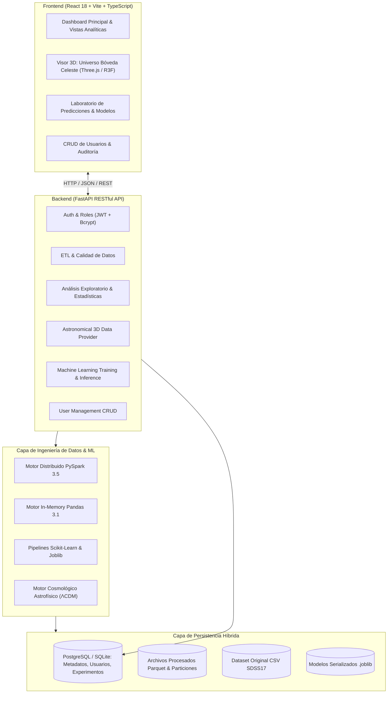

# Arquitectura de Software del Sistema Big Data SDSS-17

## 1. Visión General de la Arquitectura

La plataforma sigue una arquitectura modular en capas desacopladas, diseñada para procesar, analizar y clasificar grandes volúmenes de datos astronómicos garantizando escalabilidad, reproducibilidad y una experiencia de usuario interactiva y fluida.

---

## 2. Componentes del Backend

1. **`app/core`**:
   - `config.py`: Variables de configuración (rutas de datos, claves secretas JWT, conexión a base de datos, CORS).
   - `security.py`: Hashing de contraseñas con bcrypt, creación y validación de tokens JWT.
2. **`app/database`**:
   - `session.py`: Motor SQLAlchemy y generador de sesiones transaccionales.
   - `models.py`: Modelos ORM para usuarios, roles, ejecuciones ETL, experimentos ML y logs de auditoría.
3. **`app/etl`**:
   - `pipeline.py`: Pipeline ETL completo (Extract, Transform, Load) que limpia anomalías `-9999`, calcula índices de color, filtra y exporta a Parquet y CSV.
   - `spark_bench.py`: Módulo comparativo de rendimiento entre Pandas y PySpark (tiempo de carga, agregaciones, consumo de memoria).
   - `quality.py`: Métricas de calidad de datos (completitud, unicidad, rango válido, anomalías IQR).
4. **`app/analytics`**:
   - `eda_service.py`: Generador de estadísticas descriptivas (media, mediana, desviación, cuartiles, IQR, moda), matrices de correlación, distribución de clases y narrativas automáticas científicas.
5. **`app/machine_learning`**:
   - `trainer.py`: Entrenamiento de 6 algoritmos supervisados (Logistic Regression, Decision Tree, Random Forest, KNN, SVM, HistGradientBoosting) con evaluación multiclase, matrices de confusión y curvas ROC.
   - `interpretability.py`: Importancia de características (Feature Importance y Permutación).
   - `predictor.py`: Inferencia en tiempo real sobre nuevos objetos individuales o archivos CSV en lote.
6. **`app/astronomical_map`**:
   - `sky_service.py`: Conversión de coordenadas ecuatoriales $(\alpha, \delta)$ a coordenadas cartesianas 3D en la esfera celeste y cálculo de distancia comóvil cosmológica $D_C(z)$ para visualización espacial.
7. **`app/routers`**: Endpoints RESTful con validación Pydantic para cada funcionalidad.

---

## 3. Componentes del Frontend

- **Arquitectura**: Single Page Application con React 18, Vite y TypeScript con tipado estricto.
- **Estilos**: Tailwind CSS con tema astronómico oscuro profesional (Dark Space, Deep Navy `#0B0F19`, Starlight `#E2E8F0`, Cyan `#38BDF8`, Violet `#A855F7`, Gold `#F59E0B`).
- **Visualizador 3D**:
  - Three.js integrado vía canvas acelerado por WebGL con `THREE.Points` y `BufferGeometry` con mapeo de colores (`STAR` = Cian, `GALAXY` = Violeta, `QSO` = Oro).
  - Modos de visualización: **Modo A (Esfera celeste)** y **Modo B (Espacial estimada)**.
  - OrbitControls para rotación, pan, zoom continuo, raycasting optimizado para inspección de objetos y filtros en tiempo real.
- **Gráficos Analíticos**: Recharts con interactividad, tooltips científicos y filtros reactivos.
- **Gestión de Estado**: Context API y hooks personalizados (`useAuth`, `useAstronomicalData`, `useETL`, `useML`).

