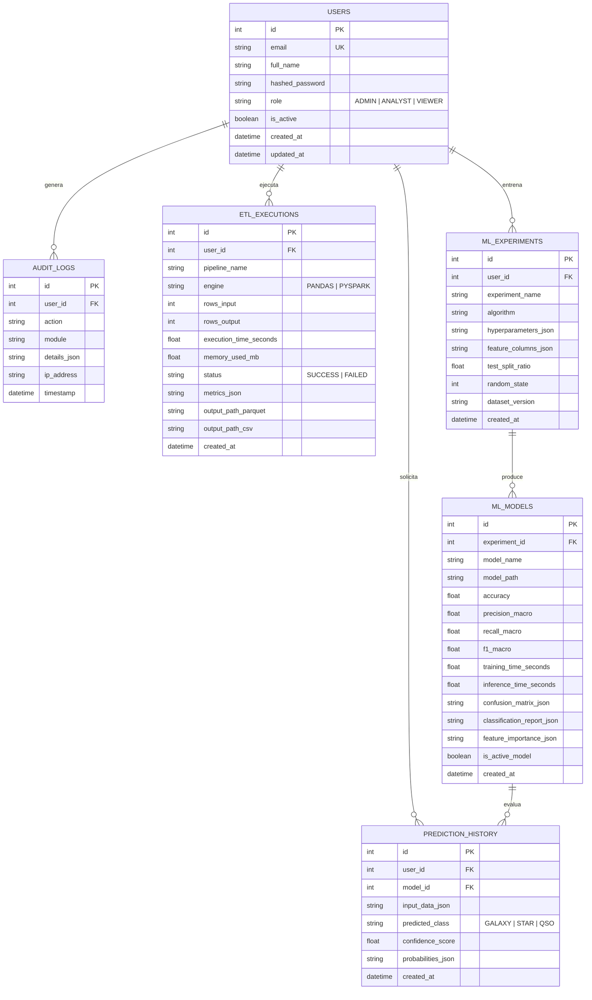

# Diseño del Modelo de Base de Datos Relacional

Para la administración del sistema, usuarios, experimentos de Machine Learning y trazabilidad de ejecuciones ETL, se implementa un modelo relacional en SQLAlchemy, preparado para PostgreSQL (en producción / Docker) y SQLite (en desarrollo local inmediato).

Los 100,000 registros científicos se almacenan en archivos optimizados Parquet y CSV en disco, mientras que los metadatos de gobernanza, trazabilidad y experimentos residen en la base de datos relacional.

---

## 1. Diagrama Entidad-Relación (ER)

---

## 2. Descripción de Tablas

### `users`
- Almacena las cuentas de usuario y credenciales con contraseñas cifradas mediante `bcrypt`.
- Soporta roles estrictos: `ADMIN`, `ANALYST`, `VIEWER`.
- Restricción de unicidad en `email`.
- Protección lógica: no permite eliminar la última cuenta administradora activa.

### `audit_logs`
- Trazabilidad y gobernanza de eventos relevantes del sistema (inicios de sesión, exportaciones, ejecuciones ETL y entrenamientos).
- Almacena detalles en formato JSON estructurado.

### `etl_executions`
- Historial de ejecuciones de limpieza y transformación de datos.
- Registra el motor de cómputo empleado (`PANDAS` o `PYSPARK`), los tiempos de ejecución, cantidad de registros filtrados, anomalías tratadas y rutas a los artefactos generados.

### `ml_experiments` & `ml_models`
- Garantizan reproducibilidad científica completa:
  - Registro exacto de hiperparámetros.
  - Conjunto de características seleccionadas.
  - Semilla aleatoria (`random_state`) y partición entrenamiento/prueba.
  - Métricas multiclase (Accuracy, Precision macro, Recall macro, F1-score macro).
  - Matrices de confusión y curvas ROC.
  - Serialización con `joblib` para despliegue productivo sin reentrenamiento.

### `prediction_history`
- Registro de predicciones generadas por los usuarios, tanto para objetos individuales como para cargas en lote vía archivo CSV.

